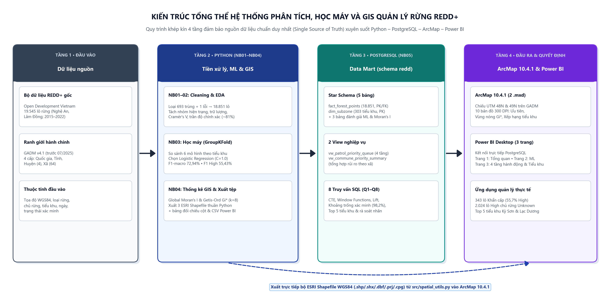
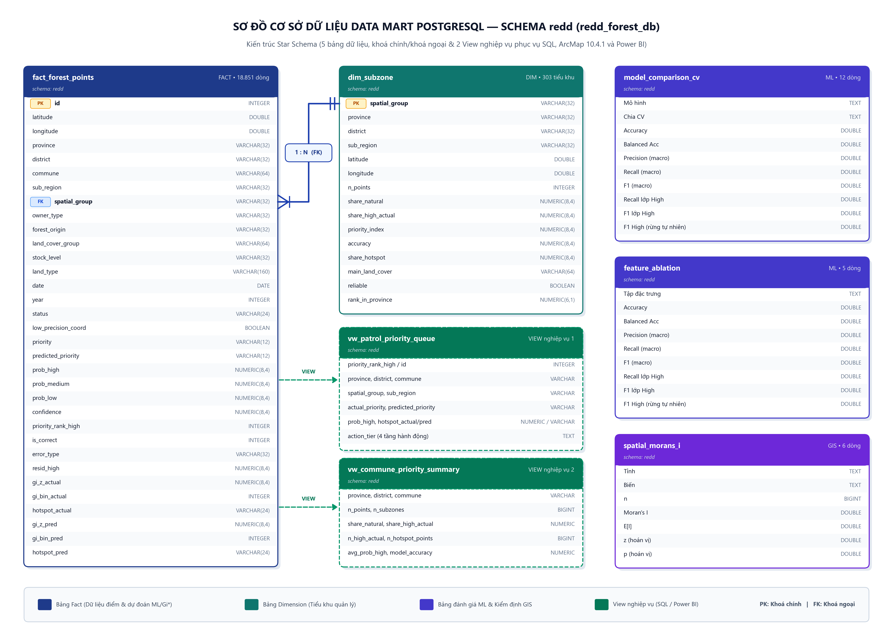
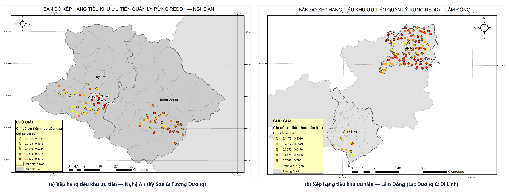
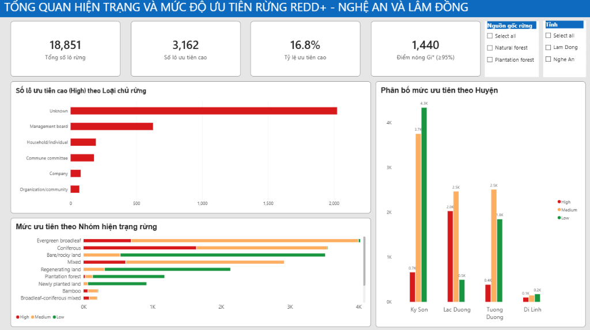
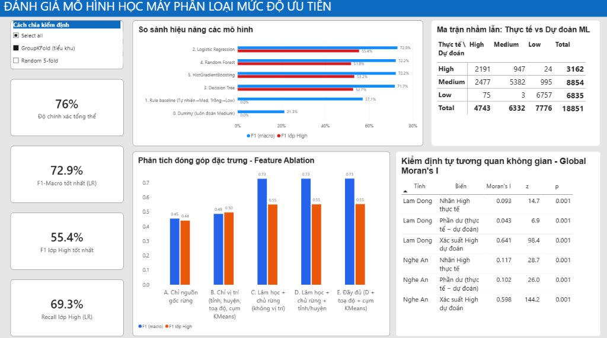
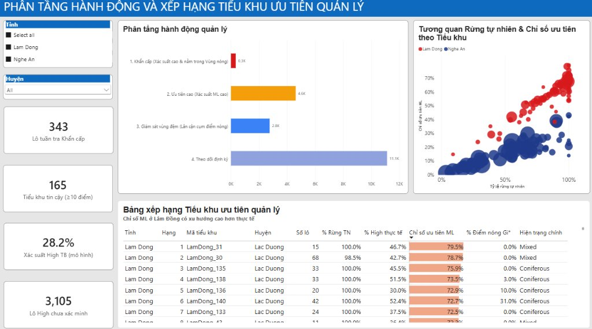

# Ứng dụng học máy và GIS trong phân tích, phân loại mức độ ưu tiên quản lý rừng tại Nghệ An và Lâm Đồng (REDD+)

> **Đồ án Chuyên ngành Tin học Tài nguyên và Môi trường** - Ngành Công nghệ Thông tin  
> **Trường Đại học Tài nguyên và Môi trường TP. Hồ Chí Minh** - Khoa Công nghệ Thông tin  
> **Sinh viên thực hiện:** Nguyễn Phúc Trọng (MSSV: `1250080214`, Lớp `12_ĐH_THMT`, Khóa `2023 – 2027`)  
> **Giảng viên hướng dẫn:** ThS. Hà Châu Hoàng

---

## 1. Tổng quan đề tài

Đề tài xây dựng một quy trình khép kín gồm **4 tầng** kết hợp **Học máy (Machine Learning)**, **Thống kê không gian GIS**, **Kho dữ liệu PostgreSQL (Star Schema)**, **Bản đồ chuyên đề ArcMap 10.4.1** và **Dashboard tương tác Power BI** nhằm phân loại mức độ ưu tiên quản lý rừng (`High / Medium / Low`), nhận diện cụm điểm nóng không gian và xếp hạng tiểu khu trọng điểm trên bộ dữ liệu kiểm kê **REDD+** tại hai tỉnh **Nghệ An** (Kỳ Sơn, Tương Dương) và **Lâm Đồng** (Lạc Dương, Di Linh).



### Kết quả chính

| Hạng mục | Chỉ số / Kết quả thực nghiệm |
|---|---|
| **Dữ liệu sau làm sạch** | `18.851` lô rừng hợp lệ (loại `693` bản ghi trùng lặp và `1` bản ghi thiếu ngày từ `19.545` bản ghi gốc); `35` xã, `303` tiểu khu (`165` tiểu khu đủ tin cậy ≥ 10 lô) |
| **Đặc trưng ảnh hưởng mạnh nhất** | Nguồn gốc rừng (`forest_origin`, Cramér's V = `0,884`): rừng tự nhiên chiếm `99,40%` (`3.143 / 3.162`) tổng số lô `High` |
| **Trần độ chính xác ước lượng** | `81,06%` (nhóm theo `land_type + tiểu khu + chủ rừng`), phản ánh ~`18,9%` nhiễu nhãn thực địa giữa `High` và `Medium` |
| **Mô hình học máy tốt nhất** | **Logistic Regression (`C = 1.0`, `balanced`)** dưới kiểm định `StratifiedGroupKFold` theo tiểu khu: `Accuracy = 76,02%`, `F1-macro = 72,94%`, `Recall High = 69,29%`, `F1 High = 55,43%`, nhầm chéo `High ↔ Low` chỉ `0,53%` |
| **Hiệu quả xếp hạng tuần tra** | Chọn Top `20%` lô có xác suất `prob_high` cao nhất phát hiện `56,8%` tổng số lô `High` thực tế (**Lift = 2,84×**); Top `30%` đạt `76,0%` (**Lift = 2,53×**) |
| **Thống kê không gian (k = 8)** | Global Moran's I dương có ý nghĩa (`p = 0,001`): Nghệ An `I = 0,1167`, Lâm Đồng `I = 0,0927`; `1.440` điểm nóng thực tế (`Gi* ≥ 95%`), trùng `59,5%` với vùng nóng dự báo |
| **Phân tích nghiệp vụ SQL** | `343` lô tầng **Khẩn cấp** (`55,7%` mang nhãn `High` kiểm kê); `3.105 / 3.162` (`98,2%`) lô `High` chưa xác minh thực địa; nhóm chủ rừng `Unknown` chiếm `64,4%` lô `High` rừng tự nhiên |

---

## 2. Cấu trúc thư mục dự án

```text
redd-forest-priority/
├── .env.example                          # Mẫu cấu hình kết nối PostgreSQL (sao chép sang .env)
├── .gitignore                            # Ẩn mật khẩu (.env), __pycache__, tệp khóa Word/ArcGIS
├── requirements.txt                      # Danh sách thư viện Python cần thiết
├── README.md                             # Tài liệu giới thiệu và hướng dẫn chạy dự án
│
├── data/
│   ├── raw/
│   │   └── redd_plus_en.csv              # Bộ dữ liệu REDD+ gốc (19.545 bản ghi, 17 cột)
│   └── processed/
│       ├── redd_plus_cleaned.csv         # Dữ liệu sạch & đặc trưng lâm học (18.851 bản ghi)
│       └── redd_predictions_for_gis.csv  # Dự đoán Out-Of-Fold (OOF) & xác suất từ GroupKFold
│
├── notebooks/
│   ├── 01_data_cleaning.ipynb            # Làm sạch dữ liệu, kiểm tra tọa độ, tách đặc trưng lâm học
│   ├── 02_eda.ipynb                      # Phân tích khám phá (EDA), Cramér's V, trần độ chính xác
│   ├── 03_modeling.ipynb                 # So sánh 6 mô hình (Random vs GroupKFold), Ablation, Tuning
│   ├── 04_spatial_analysis_gis.ipynb     # Moran's I, Getis-Ord Gi*, xếp hạng tiểu khu & xuất Shapefile
│   └── 05_postgresql_analytics.ipynb     # Đồng bộ Data Mart PostgreSQL & thực thi 8 truy vấn SQL
│
├── src/
│   ├── __init__.py
│   ├── model_utils.py                    # Lớp KMeans không gian tùy biến cho Pipeline Scikit-learn
│   ├── spatial_utils.py                  # KNN weights, Moran's I, Gi* & hàm xuất ESRI Shapefile thuần Python
│   └── db_utils.py                       # Đồng bộ Star Schema (5 bảng, PK/FK, 2 Views) lên PostgreSQL / SQLite
│
├── sql/
│   ├── 01_schema_postgres.sql            # DDL tạo schema redd, 5 bảng Star Schema và 2 View nghiệp vụ
│   └── 02_analytical_queries.sql         # Bộ 8 câu truy vấn SQL phân tích nghiệp vụ (CTE, Window Functions)
│
└── outputs/
    ├── arcmap/
    │   ├── boundary/                     # Ranh giới hành chính cắt gọn từ GADM 4.1 (Nghệ An & Lâm Đồng)
    │   ├── exports/                      # 10 bản đồ chuyên đề 300 DPI (5 bản đồ Nghệ An + 5 bản đồ Lâm Đồng)
    │   ├── mxd/                          # 2 dự án ArcMap 10.4.1 (Nghe_An.mxd & Lam_Dong.mxd)
    │   └── document                      # file word và powerpoint
    ├── figures/                          # Biểu đồ thống kê EDA, ML, GIS và sơ đồ ERD PostgreSQL
    ├── gis/                              # 3 bộ ESRI Shapefile WGS84 + bảng đối chiếu tên cột DBF ≤ 10 ký tự
    ├── models/
    │   └── best_model.joblib             # Mô hình Logistic Regression huấn luyện hoàn chỉnh
    ├── powerbi/
    │   ├── redd.pbix                     # Tệp Dashboard Power BI Desktop 3 trang
    │   └── *.csv                         # Các bảng dữ liệu chuẩn hóa phục vụ Data Mart & BI
    ├── tables/                           # 23 bảng CSV kết quả (EDA, ML, GIS, SQL Q1–Q8)
    └── word_images/                      # Hình kiến trúc, ERD, ảnh chụp Power BI và 5 cặp bản đồ ArcMap
```

---

## 3. Sản phẩm trực quan nổi bật

### Cơ sở dữ liệu Data Mart PostgreSQL (Star Schema — `schema redd`)


### Bản đồ chuyên đề trên ArcMap 10.4.1 (300 DPI — UTM Zone 48N & 49N)
Bộ sản phẩm gồm **10 bản đồ chuyên đề** (Mức ưu tiên thực tế vs ML, Vùng nóng `Getis-Ord Gi*` thực tế vs ML, và Xếp hạng tiểu khu cho từng tỉnh):



### Dashboard tương tác 3 trang trên Power BI Desktop
Kết nối trực tiếp với cơ sở dữ liệu **PostgreSQL (`redd_forest_db`)**:

| Trang 1 — Tổng quan hiện trạng | Trang 2 — Đánh giá mô hình & Moran's I | Trang 3 — Phân tầng hành động & Tiểu khu |
|---|---|---|
|  |  |  |

---

## 4. Hướng dẫn cài đặt và chạy chương trình

### Bước 1: Cài đặt môi trường Python (khuyến nghị Python 3.11+)
```bash
git clone https://github.com/Nguyentrong243/redd-forest-priority.git
cd redd-forest-priority
pip install -r requirements.txt
```

### Bước 2: Cấu hình kết nối PostgreSQL cục bộ (không đẩy mật khẩu lên Git)
1. Tạo cơ sở dữ liệu trống tên `redd_forest_db` trên PostgreSQL (qua `pgAdmin 4` hoặc `psql`).
2. Sao chép tệp mẫu `.env.example` thành `.env` và điền mật khẩu cục bộ của bạn:
   ```bash
   cp .env.example .env
   ```
   Nội dung tệp `.env`:
   ```env
   POSTGRES_URI=postgresql+psycopg2://postgres:<MAT_KHAU_CUA_BAN>@localhost:5432/redd_forest_db
   ```
   *(Nếu máy chưa cài PostgreSQL, Notebook 05 vẫn chạy đầy đủ thông qua bản cơ sở dữ liệu cục bộ SQLite tự động tạo tại `outputs/sql/redd_warehouse.db`.)*

### Bước 3: Chạy tuần tự 5 Jupyter Notebooks
Mở thư mục `notebooks/` trong Jupyter Notebook hoặc VS Code và chạy **Run All** theo thứ tự:
1. `01_data_cleaning.ipynb` — Làm sạch dữ liệu và tạo đặc trưng lâm học.
2. `02_eda.ipynb` — Phân tích khám phá dữ liệu, Cramér's V và ước lượng trần độ chính xác.
3. `03_modeling.ipynb` — So sánh 6 mô hình (`Random 5-fold` vs `StratifiedGroupKFold`), Feature Ablation và xuất dự đoán OOF.
4. `04_spatial_analysis_gis.ipynb` — Tính Global Moran's I, Getis-Ord Gi* (`k = 8`), xếp hạng tiểu khu và xuất 3 bộ ESRI Shapefile trong `outputs/gis/`.
5. `05_postgresql_analytics.ipynb` — Nạp Star Schema lên PostgreSQL (`schema redd`: 5 bảng, khóa chính/ngoại, 2 View) và thực thi 8 truy vấn phân tích (`sql/02_analytical_queries.sql`).

### Bước 4: Mở bản đồ ArcMap 10.4.1 và Dashboard Power BI
- **ArcMap 10.4.1:** Mở `outputs/arcmap/mxd/Nghe_An.mxd` (UTM Zone 48N) hoặc `outputs/arcmap/mxd/Lam_Dong.mxd` (UTM Zone 49N). Chi tiết thiết lập ký hiệu và hệ chiếu xem tại [outputs/arcmap/HUONG_DAN_ARCMAP.md](outputs/arcmap/HUONG_DAN_ARCMAP.md).
- **Power BI Desktop:** Mở [outputs/powerbi/redd.pbix](outputs/powerbi/redd.pbix), kết nối tới PostgreSQL `localhost:5432/redd_forest_db` và chọn **Refresh**.

---

## 5. Nguồn dữ liệu và lưu ý về địa giới hành chính

- **Dữ liệu REDD+:** Open Development Vietnam — [https://data.vietnam.opendevelopmentmekong.net/vi/dataset/redd_vn](https://data.vietnam.opendevelopmentmekong.net/vi/dataset/redd_vn) (2024).
- **Ranh giới hành chính:** GADM phiên bản 4.1 (2022) — [https://gadm.org/](https://gadm.org/).
- **Lưu ý địa giới hành chính:** Từ ngày **01/07/2025**, Việt Nam sắp xếp lại đơn vị hành chính theo mô hình chính quyền địa phương 2 cấp (bỏ cấp huyện) và hợp nhất tỉnh (trong đó tỉnh Lâm Đồng mới sáp nhập từ Lâm Đồng, Đắk Nông và Bình Thuận). Để đồng bộ với thời điểm thu thập dữ liệu REDD+ (`2015–2022`) và lớp bản đồ GADM 4.1 (`2022`), dự án giữ nguyên tên gọi và ranh giới hành chính cũ tại thời điểm khảo sát.
